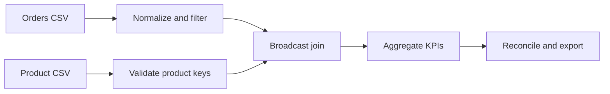

# Retail Sales Data Pipeline with PySpark

An educational ETL portfolio project for retail sales analytics using entirely synthetic data.

## Overview

Process heterogeneous CSV sales records, join a product reference table, validate data quality and calculate global and category-level business KPIs.

## Technologies


## Architecture



## Features

- Multiple date and monetary formats; decimal monetary arithmetic
- SKU normalization and duplicate-key validation
- January 2025 EUR sales with positive quantities and parseable amounts
- Anti-join audit of unmatched products; broadcast join for small reference data
- Revenue, costs, distinct orders and customers, margin, markup and margin percentage
- Reconciliation of additive metrics and CSV export using Spark


## Project Structure

```text
sales-data-pipeline-pyspark/
├── data/
│   ├── orders_raw.csv
│   └── product_ref.csv
├── notebooks/
│   └── retail_sales.ipynb
├── src/
│   └── pipeline.py
├── tests/
│   └── test_pipeline.py
├── .gitignore
├── requirements.txt
└── README.md
```

## Run locally

Requires Python 3.10+ and Java 17 or 21 compatible with Spark 4.0.1.

```bash
python3 -m venv .venv
source .venv/bin/activate
pip install -r requirements.txt
python src/pipeline.py
python -m pytest -q
```

Spark writes CSV part files under `outputs/global/` and `outputs/by_category/`.

## Results & Business KPIs

| Metric | Expected value |
|---|---:|
| Units | 18 |
| Distinct orders | 4 |
| Distinct customers | 3 |
| Revenue | EUR 2,395.50 |
| Cost | EUR 1,125.00 |
| Margin | EUR 1,270.50 |

Distinct customer and order counts cannot generally be summed across categories. Markup = margin / cost; margin percentage = margin / revenue. Zero denominators return null.

## Scope and limitations

Synthetic sample only; local Spark execution, not a production deployment or performance benchmark. Currency conversion, full reject exports, orchestration and incremental ingestion are future extensions. The reference is assumed small enough to broadcast.
